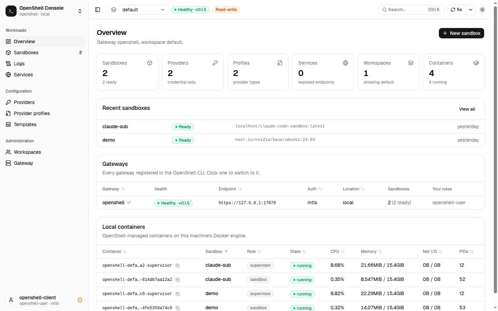
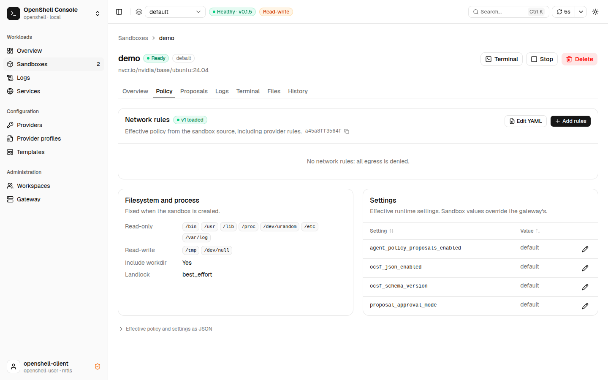
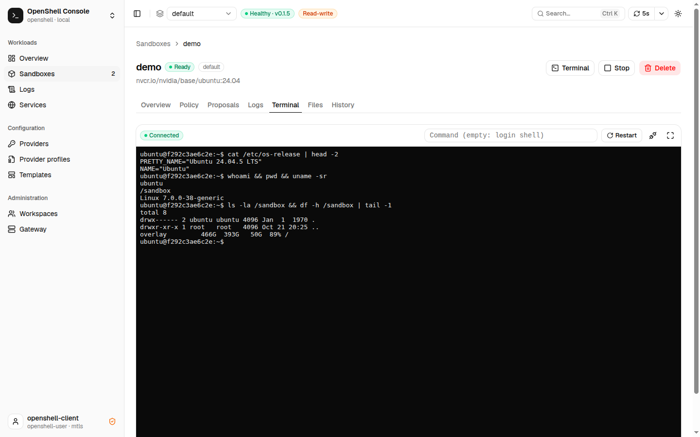
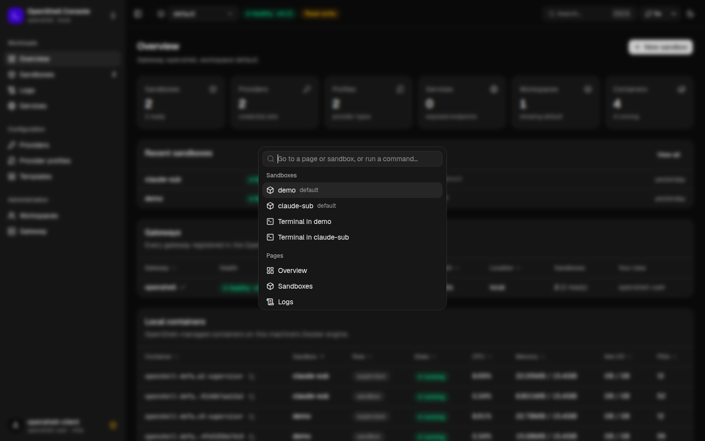
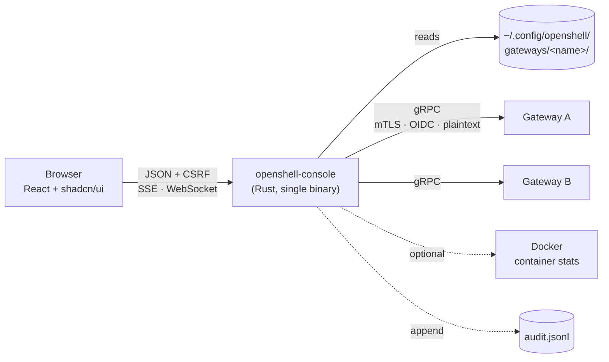

<div align="center">

# 🐚 OpenShell Console

### A web console for [OpenShell](https://github.com/NVIDIA/OpenShell). Everything you do with the `openshell` CLI (sandboxes, policies, proposals, providers, workspaces) from your browser, without giving up its security model.

One small binary (Rust backend, React UI embedded). It reuses the gateways and credentials
your `openshell` CLI already has, runs on `127.0.0.1`, and can do only what your gateway
identity is allowed to do. No extra accounts, no database.

[](https://github.com/shaharia-lab/openshell-webui/actions/workflows/ci.yml)
[](LICENSE)
[](backend/)
[](frontend/)
[](https://github.com/shaharia-lab/openshell-webui/stargazers)
[](https://github.com/shaharia-lab/openshell-webui/commits/main)

**[Quickstart](#-quickstart) · [Features](#-what-can-you-do) · [Security](#-security-model) · [Configuration](#%EF%B8%8F-configuration) · [Development](#%EF%B8%8F-development) · [Contributing](#-contributing)**

<br>

### ⭐ Find it useful? [Star the repo.](https://github.com/shaharia-lab/openshell-webui)

It takes two seconds, and it is how the next OpenShell user finds it.

</div>

---

> [!IMPORTANT]
> **Unofficial project.** OpenShell Console is an independent community tool. It is not
> affiliated with, endorsed by, or supported by NVIDIA. For OpenShell itself, see the
> [official repository](https://github.com/NVIDIA/OpenShell) and
> [documentation](https://docs.nvidia.com/openshell/latest/index.html).

---

## 🎬 A look around

<table>
<tr>
<td width="50%"></td>
<td width="50%"></td>
</tr>
<tr>
<td width="50%"></td>
<td width="50%"></td>
</tr>
</table>

---

## ⚡ Quickstart

Three steps, about two minutes.

<details open>
<summary><b>1. Check the prerequisites</b></summary>

<br>

| You need | Why | Check |
|---|---|---|
| **OpenShell CLI** with a registered gateway | the console uses its gateway registry and credentials | `openshell status` says `Connected` |
| **Rust** (stable) and **Bun** | build the backend and the frontend | `cargo --version`, `bun --version` |
| **Docker** *(optional)* | live container stats for local sandboxes, or running the console as a container | `docker ps` |

</details>

<details open>
<summary><b>2. Clone and run</b></summary>

<br>

```bash
git clone https://github.com/shaharia-lab/openshell-webui.git
cd openshell-webui
make run
```

`make run` checks the tools, starts the local gateway if it is not reachable (systemd user
unit or Homebrew service), builds one release binary with the UI embedded, and opens
**http://127.0.0.1:8787**.

<details>
<summary>Already built? Run the binary directly</summary>

```bash
make build
./bin/openshell-console --open
```

</details>

<details>
<summary>Rather not install Rust and Bun? Run it with Docker</summary>

<br>

Each release publishes an image for `linux/amd64` and `linux/arm64` to
`ghcr.io/shaharia-lab/openshell-console` (tagged `latest`, `X.Y` and `X.Y.Z`).

```bash
docker run --rm --name openshell-console \
  --network host \
  --user "$(id -u):$(id -g)" \
  -v ~/.config/openshell:/home/app/.config/openshell:ro \
  -v openshell-console-state:/home/app/.local/state \
  ghcr.io/shaharia-lab/openshell-console:latest
```

Then open **http://127.0.0.1:8787**. Add flags after the image name, e.g. `--read-only` or
`--addr 127.0.0.1:9000`.

- `--network host` is required. A local gateway listens on `127.0.0.1` only, which a
  container on Docker's default bridge network cannot reach. On the host network the
  console also keeps listening on loopback only.
- `--user` runs the console as you, so it can read your gateway's mTLS key (`0600`). The
  registry is mounted read-only; the second volume keeps the audit log across restarts.
- The image has no `docker` CLI and no journal, so the Overview's live container stats and
  the local gateway log are not available. Everything that goes through the gateway works.

</details>

</details>

<details open>
<summary><b>3. Pick how much power you want</b></summary>

<br>

```bash
make run                              # read-write
make run ARGS=--read-only             # look, but never change anything
make run ADDR=127.0.0.1:9000          # another port
```

</details>

> [!TIP]
> Start with `--read-only` on a shared or production gateway. Every write is refused before
> it reaches the gateway, so you can explore safely.

---

## 🧭 What can you do?

| Area | You can… |
|---|---|
| **Overview** | See every registered gateway and its health, sandbox counts, and live CPU / memory of local OpenShell containers |
| **Sandboxes** | Create (image or template, network rules, providers, resources, GPUs, labels, environment, services), start, stop, delete |
| **Policy** | Read the effective policy including provider rules, add or remove rules, endpoints and binaries, edit the whole policy as YAML, change settings |
| **Proposals** | Review rules drafted from denied traffic as a diff, edit them, then approve, reject, undo, approve all or clear |
| **History** | Browse every policy version and diff any two |
| **Logs** | Stream gateway and sandbox logs live, filter by source, level, time and text, and spot denied connections |
| **Terminal** | Open a shell or run a one-off command in a sandbox (xterm.js over WebSocket) |
| **Files** 🆕 | Browse a sandbox's file system: upload (drag and drop), download, preview, edit, create folders, delete |
| **Services** | Expose sandbox HTTP ports through the gateway and remove them |
| **Providers** | Manage credentials (never shown again after saving), rotation, expiry and automatic refresh; check readiness per sandbox |
| **Provider profiles** | Import, lint, edit and delete profiles in CLI YAML or proto JSON |
| **Templates** | Create and delete reusable sandbox templates |
| **Workspaces** | Create and delete workspaces, manage members and roles |
| **Gateway** | See your identity and roles, compute drivers, extensions, gateway-wide settings, the gateway's own log, and the console's audit log |

Everything is scoped by **gateway** and **workspace** (or *all workspaces*), refreshes
automatically, works in light and dark mode, and adapts to small screens. The gateway
enforces roles: the console can do only what the signed-in identity may do.

---

## 🏗️ How it works



The backend calls the gateway through **reflection** over the upstream protos: one dynamic
gRPC codec serves every method, and secret fields are found from the proto annotations
rather than a hand-kept list. See [backend/README.md](backend/README.md) and
[frontend/README.md](frontend/README.md) for the details.

<details>
<summary><b>Authentication</b>: the same credentials as the CLI</summary>

<br>

The server reads each gateway from `~/.config/openshell/gateways/<name>/`:

| Gateway auth | Files used |
|---|---|
| **mTLS** | `mtls/ca.crt`, `mtls/tls.crt`, `mtls/tls.key` |
| **OIDC** | `oidc_token.json`, sent as a bearer token and re-read on every call. Refresh it with the CLI. |
| **Plaintext** | `http://` endpoints, no credentials |

Cloudflare edge gateways are not supported yet.

</details>

<details>
<summary><b>Policy and profile formats</b></summary>

<br>

Editors accept the **CLI YAML** format, **proto-shaped YAML**, or **proto JSON**. Only known
spelling differences are converted; unknown fields are errors, and the gateway validates
the result again.

</details>

---

## 🔐 Security model

The console holds the keys to your gateways, so it is built to be boring and strict.

| Guard | What it stops |
|---|---|
| 🔒 Listens on `127.0.0.1`, rejects unknown `Host` headers | DNS rebinding and LAN access |
| 🛡️ Same-origin `Origin` check + per-start CSRF token on every write and WebSocket | cross-site request forgery |
| 🚫 API refuses cross-site requests (`Sec-Fetch-Site`) | other sites reading your gateway data |
| 📋 Allowlist of gateway methods (`backend/src/rpcs.rs`) | reaching sandbox-token, supervisor, peer or credential-export RPCs |
| 🙈 Fields marked `(openshell.options.v1.secret)` are redacted in every response | secrets reaching the browser |
| ↩️ Requests that echo a redacted value back are refused | overwriting a real secret with the mask |
| 🧾 Every write appended to an audit log (method, target, result) | silent changes; credentials and bodies are never logged |
| 🧱 Strict CSP (`script-src 'self'`), no third-party CDNs or fonts | injected or remote scripts |
| 👀 `--read-only` mode | any change at all, including terminal and file uploads |

> [!WARNING]
> **There is no login.** Anyone who can reach the port acts as your gateway identity.
> Do not expose it to other people without an authenticating reverse proxy in front
> (see `--addr` and `--allowed-host`).

---

## ⚙️ Configuration

| Flag | Environment | Default | Meaning |
|---|---|---|---|
| `--addr` | `OPENSHELL_UI_ADDR` | `127.0.0.1:8787` | listen address; keep it on loopback |
| `--open` | | off | open the UI in the default browser |
| `--read-only` | `OPENSHELL_UI_READ_ONLY` | off | refuse every action that changes state |
| `--audit-log` | `OPENSHELL_UI_AUDIT_LOG` | `$XDG_STATE_HOME/openshell-ui/audit.jsonl` | JSON-lines record of every write |
| `--gateway-log-dir` | `OPENSHELL_UI_GATEWAY_LOG_DIR` | Homebrew log dir, else the systemd journal | where the local gateway logs |
| `--allowed-host` | `OPENSHELL_UI_ALLOWED_HOSTS` | none | extra `Host` values to accept, for a reverse proxy |
| `--timeout-secs` | `OPENSHELL_UI_TIMEOUT` | `20` | timeout for one gateway call |

With `make`, set `ADDR` for the address and `ARGS` for anything else. If `DOCKER_HOST` is
unset, the console uses the one from the gateway's `gateway.env`, so it talks to the same
Docker engine as the gateway.

---

## 🧪 Examples

[`claude-sandbox/`](claude-sandbox/) runs **Claude Code inside an OpenShell sandbox**: an
Ubuntu image, a policy that lets only the `claude` binary reach Anthropic's API, and a
provider profile that injects the OAuth token so the sandbox never sees it. Create it from
the CLI or the console, then watch its egress and proposals live.

---

## 🛠️ Development

```bash
make dev            # backend (cargo watch) + frontend (Vite HMR) with hot reload
make backend-dev    # backend only, on 127.0.0.1:8787
make frontend-dev   # Vite dev server, proxies /api to the backend
make test           # cargo test + vitest
make lint           # rustfmt, clippy -D warnings, eslint, prettier, tsc
make build          # bin/openshell-console with the frontend embedded
make proto          # refresh protos from $OPENSHELL_SRC and regenerate TS types
```

In development, open the Vite URL it prints (http://localhost:5173). `make proto` expects an
OpenShell checkout at `OPENSHELL_SRC` (default `~/Projects/OpenShell`) and records the
upstream commit in `backend/proto/SOURCE_COMMIT`.

<details>
<summary><b>Project layout</b></summary>

<br>

```text
Makefile                dev, build, run, test, lint, proto
backend/                Rust: axum + tonic + prost-reflect
  proto/                protos copied from OpenShell (SOURCE_COMMIT)
  src/gateway/          CLI registry, connection pool, mTLS/OIDC, dynamic gRPC codec
  src/http/             routes, guards, SSE watch, WebSocket terminal, file browser, assets
  src/rpcs.rs           allowlist of gateway methods the browser may call
  src/redact.rs         secret redaction driven by proto annotations
  tests/api.rs          HTTP tests against an in-process fake gateway
frontend/               React 19 + TypeScript + Vite + Tailwind v4 + shadcn/ui
  src/api/              typed client, TanStack Query hooks, mutations
  src/features/         one folder per area (sandboxes, policy, logs, files, …)
  src/components/       shadcn/ui, shared building blocks, app shell
  src/gen/              types generated from the protos
claude-sandbox/         example: Claude Code in an OpenShell sandbox
```

</details>

<details>
<summary><b>Exposing another gateway method</b></summary>

<br>

1. Add it to `ALLOWED` in `backend/src/rpcs.rs` as `Read` or `Write` (writes are audited and refused in read-only mode).
2. Add it to the typed map in `frontend/src/api/rpc.ts` and call it with `useRpc(gw, "Method")`.
3. Run `make lint test`.

Never allowlist sandbox-token, supervisor, peer or credential-export RPCs. More rules for
contributors and AI agents are in [CLAUDE.md](CLAUDE.md).

</details>

---

## 🤝 Contributing

Contributions are welcome.

1. **[Open an issue](https://github.com/shaharia-lab/openshell-webui/issues/new)** describing
   **what** you want to change and **why**.
2. Fork, branch, and open a PR that links the issue (`Closes #123`).
3. Make sure `make lint test` passes and the [security model](#-security-model) still holds.

Found a security problem? Please report it privately through
[GitHub security advisories](https://github.com/shaharia-lab/openshell-webui/security/advisories/new),
not a public issue.

### Contributors

<a href="https://github.com/shaharia-lab/openshell-webui/graphs/contributors">
  
</a>

---

## ⭐ Spread the word

<div align="center">

**[⭐ Star the repo](https://github.com/shaharia-lab/openshell-webui)** ·
**[🐛 Report something broken](https://github.com/shaharia-lab/openshell-webui/issues)**

<br>

**Know someone running AI agents in OpenShell? Share it with them.**

[](https://twitter.com/intent/tweet?text=OpenShell%20Console%20%E2%80%94%20a%20secure%20local%20web%20UI%20for%20OpenShell%20sandboxes%2C%20policies%20and%20providers.&url=https%3A%2F%2Fgithub.com%2Fshaharia-lab%2Fopenshell-webui)
[](https://www.linkedin.com/sharing/share-offsite/?url=https%3A%2F%2Fgithub.com%2Fshaharia-lab%2Fopenshell-webui)
[](https://bsky.app/intent/compose?text=OpenShell%20Console%20%E2%80%94%20a%20secure%20local%20web%20UI%20for%20OpenShell%20sandboxes%2C%20policies%20and%20providers.%20https%3A%2F%2Fgithub.com%2Fshaharia-lab%2Fopenshell-webui)
[](https://www.reddit.com/submit?url=https%3A%2F%2Fgithub.com%2Fshaharia-lab%2Fopenshell-webui&title=OpenShell%20Console%20%E2%80%94%20a%20secure%20local%20web%20UI%20for%20OpenShell)
[](https://news.ycombinator.com/submitlink?u=https%3A%2F%2Fgithub.com%2Fshaharia-lab%2Fopenshell-webui&t=OpenShell%20Console%20%E2%80%94%20a%20secure%20local%20web%20UI%20for%20OpenShell)

</div>

<details>
<summary>Star history</summary>

<br>

<a href="https://star-history.com/#shaharia-lab/openshell-webui&Date">
  <picture>
    <source media="(prefers-color-scheme: dark)" srcset="https://api.star-history.com/svg?repos=shaharia-lab/openshell-webui&type=Date&theme=dark" />
    
  </picture>
</a>

</details>

---

## 📄 License

[MIT](LICENSE): do what you like, no warranty.

Third-party code keeps its own license: `backend/proto/` comes from
[NVIDIA/OpenShell](https://github.com/NVIDIA/OpenShell) (Apache License 2.0), and the Rust
crates and npm packages (including xterm.js and shadcn/ui) carry their own licenses.

Built with [Rust](https://www.rust-lang.org) · [axum](https://github.com/tokio-rs/axum) ·
[tonic](https://github.com/hyperium/tonic) · [React](https://react.dev) ·
[shadcn/ui](https://ui.shadcn.com) · [xterm.js](https://xtermjs.org) ·
for [OpenShell](https://github.com/NVIDIA/OpenShell)

<div align="center">
<br>

**Made with ❤️ by [Shaharia Lab](https://github.com/shaharia-lab)**

⭐ [Star OpenShell Console](https://github.com/shaharia-lab/openshell-webui) if it saved you a trip to the terminal.

</div>
