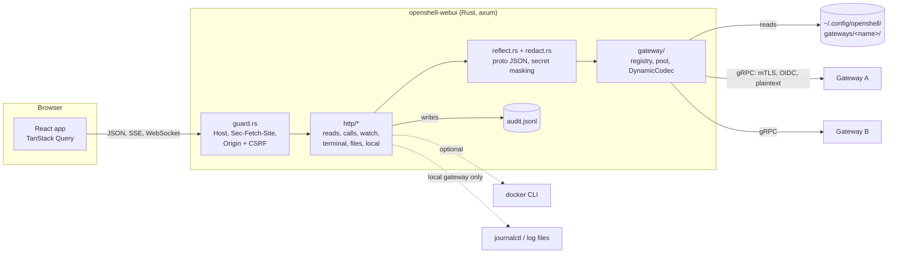
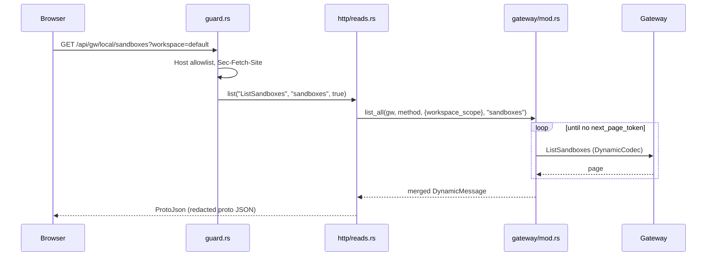
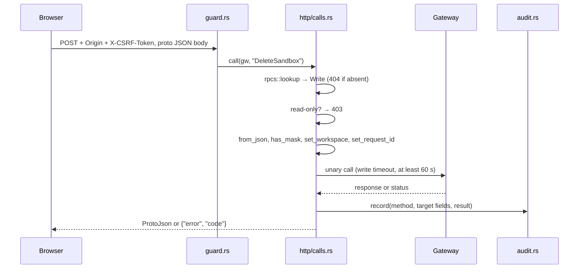
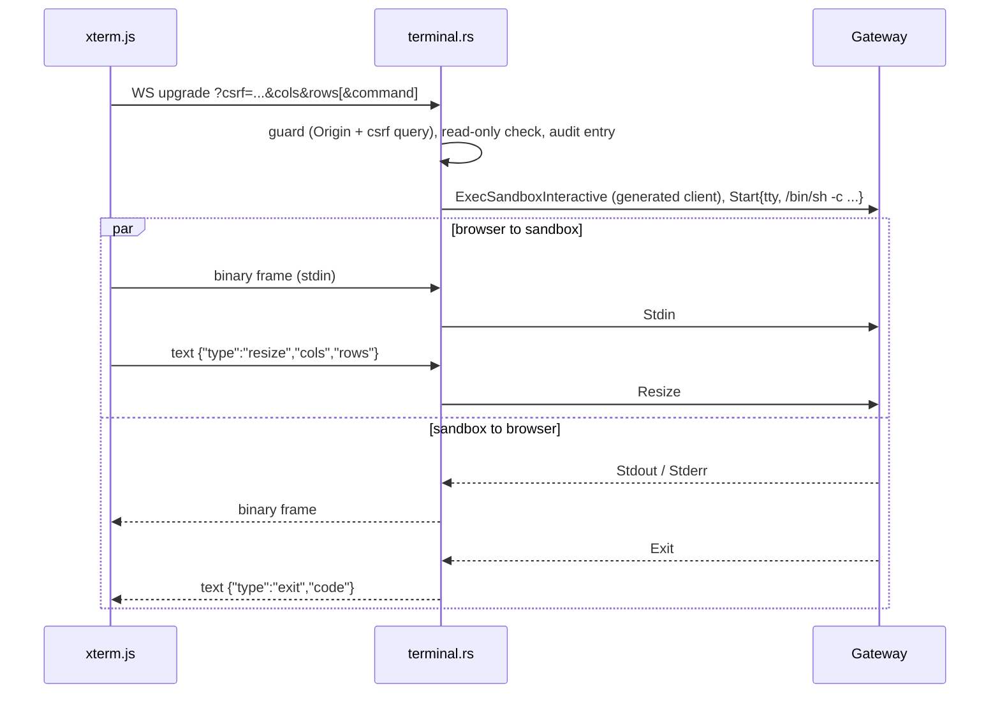
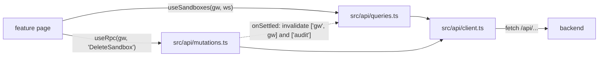

# Architecture

This page explains how the WebUI is put together: the components, how each kind of request flows through the backend, and the pieces that keep it generic over the gateway API.

## Big picture

- One binary serves the API under `/api` and, in release builds, the embedded frontend.
- The backend has no database. Its state is the CLI registry, an in-memory connection pool, a per-start CSRF token and the audit log file (`backend/src/state.rs`).
- The router in `backend/src/http/mod.rs` merges the route modules and wraps them in the guard, a 4 MiB body limit, `Cache-Control: no-store`, a panic catcher and security headers.

## Gateway registry and authentication

`backend/src/gateway/registry.rs` reads the CLI registry:

- The root is `$XDG_CONFIG_HOME/openshell`, default `~/.config/openshell`.
- Each gateway is `gateways/<name>/metadata.json` (`gateway_endpoint`, `auth_mode`, `is_remote`, ...).
- The active gateway is `$OPENSHELL_GATEWAY` or the `active_gateway` file.
- A gateway is `local` when its endpoint is loopback and it is not remote. Local-only data (Docker stats, the gateway log) belongs to it.

`backend/src/gateway/client.rs` turns an entry into a tonic channel:

| Auth mode | Transport | Per request |
|---|---|---|
| `mtls` | TLS with `mtls/ca.crt` (system roots if absent) and client identity `mtls/tls.crt` + `mtls/tls.key` | nothing |
| `oidc` | TLS | `authorization: Bearer <token>` read from `oidc_token.json` on every call, so CLI refreshes apply without a restart |
| `plaintext` | `http://` endpoint | nothing |
| `cloudflare_jwt` | not supported | the client refuses to connect |

An `http://` endpoint registered as `mtls` is treated as `plaintext`.

### Connection pool

`Gateways` in `backend/src/gateway/mod.rs` keeps one lazily connecting client per gateway name. The pool key includes the endpoint and auth mode, so a changed registry entry re-dials. `Gateways::list_all` follows `next_page_token` with a page size of 200, up to 25 pages, and returns one merged response.

## Reflection and the dynamic codec

The backend does not hand-write a wrapper per gateway method:

1. `backend/build.rs` compiles the protos in `backend/proto/` with tonic-prost-build and writes a descriptor set to `OUT_DIR/openshell_descriptor.bin`. It also generates a server with default stubs for tests.
2. `backend/src/proto.rs` embeds that descriptor set as the `POOL` (`prost_reflect::DescriptorPool`).
3. `backend/src/reflect.rs` looks up methods on `openshell.v1.OpenShell` by short name and converts proto JSON to and from `DynamicMessage`.
4. `backend/src/gateway/codec.rs` defines `DynamicCodec`, a tonic codec for `DynamicMessage`. `GatewayClient::unary` and `GatewayClient::server_streaming` call any method by its descriptor.

Only `ExecSandboxInteractive`, a bidirectional stream, uses the generated client (`GatewayClient::typed`).

### Proto JSON wire format

- Responses use proto field names (`snake_case`), int64 as strings and enums by name (`reflect::to_json`).
- Requests accept proto or JSON field names. Unknown fields are errors (`reflect::from_json`).
- The server fills `workspace_scope` from `?workspace=` (`*` means all workspaces) and an empty `request_id` with a UUID (`reflect::set_workspace`, `reflect::set_request_id`). Requests with `global: true` get no workspace scope, nor do provider profile methods called with `?scope=platform` (`rpcs::platform_scoped`; audited as workspace `platform`).

## Redaction

`backend/src/redact.rs` collects every field whose options carry `(openshell.options.v1.secret) = true` from the descriptor pool once:

- `redact` replaces secret strings and string map values with `[redacted]` and drops any other secret value, recursively.
- `has_mask` detects a request that echoes `[redacted]` back; `call` in `backend/src/http/calls.rs` refuses it with 400.
- `ProtoJson` in `backend/src/http/proto_json.rs` redacts before serializing. Every gateway message sent to the browser goes through it, including SSE events.

Because the list comes from the proto annotations, a new secret field upstream is masked as soon as you refresh the protos.

## Request lifecycles

### Read route

Example: `GET /api/gw/{gw}/sandboxes?workspace=default`.

The route factories `unary`, `list` and `sandbox_get` in `backend/src/http/reads.rs` make most reads one line.

### Allowlisted RPC call

Example: `POST /api/gw/{gw}/call/DeleteSandbox?workspace=team`.

Read methods use the normal timeout (`--timeout-secs`) and are not audited.

### SSE watch

`GET /api/gw/{gw}/sandboxes/{name}/watch` (`backend/src/http/watch.rs`) opens the server-streaming `WatchSandbox` call:

- Query flags `status`, `logs` and `events` set `follow_status`, `follow_logs` and `follow_events`. `tail`, `event_tail`, `source`, `level` and `since` filter the stream.
- Each `SandboxStreamEvent` becomes one `data:` line of redacted proto JSON.
- A gateway error becomes an `event: error` with `{"error", "code"}`, then the stream ends.
- A `ping` keep-alive goes out every 15 seconds.

The frontend reads it with `EventSource` in `frontend/src/features/logs/use-log-stream.ts`.

### WebSocket terminal

`GET /api/gw/{gw}/sandboxes/{name}/exec` (`backend/src/http/terminal.rs`) upgrades to a WebSocket and bridges it to `ExecSandboxInteractive`.

- The default command prefers `bash -il` and falls back to `sh -il`.
- WebSocket upgrades cannot set headers, so the CSRF token travels as the `csrf` query parameter (`frontend/src/features/terminal/use-terminal.ts`).

### File browser through exec

The file routes in `backend/src/http/files.rs` call `SandboxFs` in `backend/src/sandbox_fs.rs`, which runs fixed shell scripts through `exec::run` in `backend/src/exec.rs`:

- Scripts such as `find "$1" ...`, `cat > "$1"` and `rm -rf -- "$1"` take the path as a positional argument; it is never spliced into the script.
- `check_path` requires an absolute path without `..` or NUL. Removing `/` is refused.
- `exec::run` sends stdin in 512 KiB chunks, below the gateway's 1 MiB message limit, and caps output (8 MiB for listings, 64 MiB for files).
- Uploads, mkdir and delete are writes: refused in read-only mode and audited as `UploadFile`, `MakeDirectory` and `DeletePath`.

## Embedded frontend

`backend/src/http/assets.rs` is the router fallback:

- `/api/*` paths that match no route return a JSON 404.
- With the `embed-frontend` feature, `rust-embed` compiles `frontend/dist` into the binary. Files under `assets/` get a one-year immutable cache; other files get `no-cache`.
- A path without a file extension outside `assets/` gets `index.html`, so client routes survive a reload. A missing file with an extension is a 404.
- Without the feature (dev builds), non-API paths return a short HTML page that points to the Vite dev server.

## Local extras

These come from the machine, not from a gateway (`backend/src/local/`):

| Route | Source | Notes |
|---|---|---|
| `GET /api/local/containers` | `docker ps` and `docker stats` for containers labeled `openshell.ai/managed-by=openshell` (`local/docker.rs`) | 503 when the `docker` CLI is missing. Without `DOCKER_HOST`, uses the one in the registry's `gateway.env`. |
| `GET /api/local/gateway-log` | Homebrew log files `openshell-gateway.{out,err}.log`, else `journalctl` for the `openshell-gateway` user unit (`local/gateway_log.rs`) | `--gateway-log-dir` overrides the location. |

## Audit log

`backend/src/audit.rs` appends one JSON line per write to `$XDG_STATE_HOME/openshell-ui/audit.jsonl` (or `--audit-log`), created with mode `0600`:

- Fields: `time`, `gateway`, `workspace`, `method`, `target`, `result`, `error`.
- `target` keeps only identifying fields (`name`, `sandbox`, `provider`, `chunk_id`, ...) and nested `metadata.name`. A replaced `policy` is logged as `replaced`; `merge_operations` as a count. Bodies and credentials are never written.
- A failure to write the log is logged, not returned, so it never hides the outcome of a call that already ran.
- `GET /api/audit?n=` returns the last entries.

## Frontend data flow

- All server state goes through TanStack Query hooks in `frontend/src/api/`.
- Query keys for a gateway start with `['gw', name]` (`qk` in `queries.ts`), so `useRpc` refreshes everything for that gateway after a write with one invalidation.
- `useRpc(gw, method)` is typed from `RpcMap` in `frontend/src/api/rpc.ts`. `useGwCall` runs an allowlisted read method as a query.
- `client.ts` fetches the CSRF token from `/api/session`, sends it as `X-CSRF-Token`, and refetches and retries once on a CSRF error.
- Types in `frontend/src/gen/` are generated from the same protos with ts-proto, in the proto JSON shape. See [Frontend](frontend.md#generated-types).

## Related

- [Backend](backend.md)
- [Frontend](frontend.md)
- [Security](security.md)
- [User guide: concepts](../user-guide/concepts.md)
